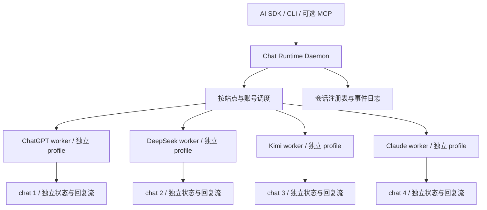

# 0042 面向 AI 的多站点并行聊天运行时

## Status

第一版已实现 Chromium/Playwright 后台运行时、独立 worker/profile、SDK/CLI、本地事件流与恢复保护。四站点模拟页面已覆盖；真实账号兼容性待验收。Moli 作为后续资源优化项。使用方式见 [chat-web README](../../modules/chat-web/README.md)。

## Owner

TBD

## Date

2026-10-25

## Summary

构建主要由 AI、CLI 和 SDK 调用的常驻聊天运行时，同时管理 Kimi、DeepSeek、ChatGPT、Claude 等站点的多个独立 chat。优先级是并行执行、会话状态隔离和故障范围可控。产品默认通过进程接口提供服务，可在登录、验证或诊断时临时显示对应页面，无需常驻浏览器窗口或标签管理界面。

运行时内部持有浏览器执行 worker、站点适配器和消息解析器。先验证常驻 Chromium worker 与现有 chat-web 适配器，再根据流采集能力决定是否使用 Electron 或 CEF 宿主；完整浏览器产品与 Min 界面复用不作为第一阶段目标。状态隔离需要独立存储上下文，强故障隔离需要独立浏览器进程。站点协议、账号配额和服务端限制仍是共享约束。

## Context

现有实现已具备 SDK、持久化登录、provider adapter 和部分网络回复解析，可以复用。但以下耦合阻碍多个调用者共享浏览器：

| 现有实现 | 对外部调用的影响 |
| --- | --- |
| [profile-manager.ts](../../modules/chat-web/src/core/profile-manager.ts) 按 provider 管理 profile | 尚无显式的 provider 内多账号模型 |
| [browser.ts](../../modules/chat-web/src/core/browser.ts) 每次 open 启动持久化 context，并检查 profile 所有权 | 相同 profile 不能由多个任务分别启动浏览器使用 |
| [session.ts](../../modules/chat-web/src/session.ts) 持有 context 和一个 page，FIFO 串行执行 send 与 newChat，close 关闭 context | 账号、浏览器资源与单个对话生命周期绑定 |
| [chatgpt-sse-collector.ts](../../modules/chat-web/src/providers/chatgpt-sse-collector.ts) 等待 response.finished 后读取正文 | 已能恢复原始 Markdown，但该路径并非逐网络 chunk 输出 |
| [chat-web-session.js](../../modules/ai-sdk/src/providers/chat-web-session.js) 将进度转换为状态预览，最终发送 assistant 消息；interrupt 只设置本地标记 | 缺少独立、可重连的 turn 事件流和已确认的网页停止操作 |
| [resume/chat-web.js](../../modules/ai-sdk/src/resume/chat-web.js) 明确不支持跨进程对话恢复 | 保存 SDK session id 无法保证重启后继续原网页对话 |

需求是让 chat 成为运行时管理的独立资源：外部 AI 无需管理窗口、焦点、选择器或浏览器进程，可以同时提交多个跨站点任务，并分别接收、停止和恢复它们。当前内置网页适配器只有 ChatGPT、DeepSeek 和 Gemini；Kimi 与 Claude 网页需要新增适配器，现有 AI SDK 中同名 CLI 或官方 SDK 后端不能视为已有网页支持。

本提案延续 [RFC 0028](0028-chat-web-implementation-plan.md) 的专用站点适配思路，重新设计其单账号串行与会话拥有浏览器的边界。现有运行时行为在迁移前保持有效。

## Goals

- 以后台 daemon、SDK 和 CLI 提供服务，界面仅用于必要的人工接管。
- 支持跨站点并行，以及单站点多个独立 chat 的并行。
- 每个活跃 chat 独占存储环境、页面、适配器状态和事件通道；取消、关闭或重启一个 worker 不主动操作其他 chat。
- 同一对话的 turn 保持有序，不同对话按账号能力和机器资源调度。
- 提供稳定 id、结构化消息、重连和恢复；支持 Kimi、DeepSeek、ChatGPT、Claude 等可扩展站点适配。

## Non-Goals

- 第一阶段自行开发或 fork Chromium、Blink、JavaScript 引擎。
- 承诺任意网页通用适配、无限并行或所有站点完全相同的能力。
- 将网页订阅等同于官方 API 的配额、可用性和服务保证。
- 第一阶段实现通用浏览器的完整书签、扩展与同步产品。

## Options Considered

| 方案 | 适用性与取舍 |
| --- | --- |
| 常驻 Chromium worker 加 Playwright | 最容易复用代码，适合先验证独立 profile、跨站点并发与消息隔离；仍需验证控制链和真实流式采集，不能直接沿用单 profile 单 session 管理 |
| Electron 宿主 | 具备 WebContentsView、持久化 session 与进程通信，适合作为可选内嵌宿主；不要求提供完整浏览器 UI，需要承担 Chromium 分发、更新与兼容测试 |
| 修改开源浏览器 Min | Min 基于 Electron，可参考实现；本需求主要面向 AI，完整浏览器 UI 复用收益有限，暂不优先 fork |
| CEF 加最小原生界面 | 支持嵌入 Chromium、进程通信和响应数据过滤；原生控制更直接，需要维护 C++ 集成和跨平台打包 |
| 系统 Chrome 加扩展与本地宿主 | 嵌入式浏览器兼容性不满足时的候选；保留聊天语义协议，重新验证扩展权限与流采集 |
| Tauri 2 默认系统 WebView | 官方文档显示桌面平台分别使用 WebView2 或 WebKit；包体优势需与跨引擎适配成本一起评估 |
| Moli | 独立 Rust 浏览器内核，基础隔离与增量流已通过本地 v1.1.19 实验；有 ChatGPT demo。适合作为可替换 worker 引擎，真实站点兼容性仍需验证，附加持久化 context 受限 |
| Lightpanda 等新浏览器引擎 | 有面向机器的接口和资源优化方向，但目标站点的登录、流式协议和完整应用行为必须单独验证 |

选型依据：[Electron WebContentsView](https://www.electronjs.org/docs/latest/api/web-contents-view)、[Electron session](https://www.electronjs.org/docs/latest/api/session)、[Min 源码](https://github.com/minbrowser/min)、[Min package.json](https://github.com/minbrowser/min/blob/master/package.json)、[CEF](https://github.com/chromiumembedded/cef)、[Tauri 2 WebView](https://v2.tauri.app/reference/webview-versions/)、[Lightpanda](https://github.com/lightpanda-io/browser)。以上判断针对当前仓库和聊天场景，不代表目标站点已通过验证。

### Moli 调研结果

[Moli 调研与可复现实验](../research/moli/README.md) 使用源码快照 26d2d182 和官方 v1.1.19 macOS arm64 二进制。模拟聊天流实验验证了同源 context 存储隔离、双路增量接收、单 context 关闭隔离、双进程故障隔离，以及 Browser.close 后的 profile 恢复。结果支持将 Moli 列为候选执行引擎；尚未验证四个真实站点的登录和对话链路。

建议在 BrowserHost 后增加可替换的 Moli 后端，按 chat 使用独立进程与 profile，保留 Chromium 基线。附加 context 的 persistentPartitionId 明确返回不支持；SIGTERM 立即退出，不能替代协议关闭与持久化确认。上游 ChatGPT demo 默认借助 Chromium 认证，并保留刷新后读取回复的路径，不能作为完整实时聊天兼容性已通过的证据。

## Proposed Design

### 后台服务与执行 worker



daemon 管理注册表、调度、worker 监督与持久化日志；每个 worker 管理自己的浏览器环境、页面、适配器实例及流解析器。相同 provider 可以有多个 worker，图中的四类并非四个全局单例。共享的只读适配器代码与配置可以复用，本轮消息缓冲、计时器和取消控制器不跨 chat 共享。

外部只使用聊天协议，不暴露 Playwright Page、任意 JavaScript 执行和选择器。内部 BrowserHost 封装启动、存储、页面操作和流采集，允许以后采用 Electron 或 CEF。headless、后台窗口与临时可见模式按站点兼容性选择，不将无界面运行当成所有站点都已支持。

### chat 的隔离边界

| 资源 | 生命周期与隔离规则 |
| --- | --- |
| Account | provider 加 accountId，表示站点身份与配额归属，不直接等同于共享浏览器存储 |
| Conversation | 稳定本地 id，映射站点 conversation id、URL 和存储环境；两个 chat 不默认指向同一站点会话 |
| Worker | 一个活跃 chat 独占执行环境。第一阶段使用独立浏览器进程与持久化 profile，实现可单独停止与回收 |
| Turn | conversation 内的有序发送，独立 requestId、状态、事件序号、缓冲区和取消控制器 |

仅在同一个 session 或 context 中创建多个 tab 不能提供完整存储隔离。Playwright BrowserContext 提供 cookies、localStorage、sessionStorage 等状态隔离，但共用浏览器进程时仍共享该进程的故障范围；进程级隔离是更强、资源开销也更高的选择。[BrowserContext 隔离](https://playwright.dev/docs/browser-contexts)

第一阶段每个 chat 绑定独立持久化目录，例如 `profiles/<provider>/<accountId>/<chatId>/`，由一个 worker 独占。关闭或回收 chat 只停止该 worker，保留对话映射与 profile 供恢复；同一目录不能同时启动两个浏览器实例。[持久化 context](https://playwright.dev/docs/api/class-browsertype#browser-type-launch-persistent-context)

多个隔离环境的登录需要明确处理：先支持在每个 profile 中分别完成授权。只有站点验证允许时，才从受控认证快照初始化新 context；不复制活跃 profile，也不假设 cookies 或 storageState 能完整覆盖登录所需的状态。独立 profile 不会把同一账号的额度或服务端会话变成独立账号。[认证状态复用](https://playwright.dev/docs/auth)

后续可评估同一浏览器进程内的多 context 模式以降低内存，必须明确其较弱的故障边界。Electron 中同 partition 多 WebContents 会共享 session，不作为严格隔离模式；即便使用不同 partition，也不能直接承诺浏览器进程故障相互独立。[Electron session](https://www.electronjs.org/docs/latest/api/session)

daemon 的注册表只在短事务中更新，不能持全局锁等待生成。worker 的超时、崩溃和重启按 chatId 处理；daemon 自身或整机故障仍可影响多个连接，使用日志与重连恢复，不能把本地隔离承诺扩展为基础设施完全独立。

### 发送与回复采集

发送前安装本轮监听器、持久化待发送记录，再操作页面。第一版沿用可验证的站点输入和发送行为，在页面局部执行。若某平台必须短暂聚焦才能发送，只串行化该动作，不在等待回复时独占全局焦点。

回复优先解析网页本身产生的结构化网络数据，保留 Markdown、message id 与明确结束标记；DOM 或可访问性信息用于状态检查和降级读取。现有 ChatGPT SSE 逻辑拆成与 Playwright 无关的纯解析器复用。降级结果携带内容来源与格式保真信息。

Electron 的 `webRequest` 提供请求生命周期、状态和头信息，不能据此直接实现响应正文 chunk 订阅。同一事件只使用最后注册的 listener，因此应由宿主统一分发，避免适配器互相覆盖。[WebRequest](https://www.electronjs.org/docs/latest/api/web-request)

真实流式采集要通过实验选择：

| 采集路径 | 必须验证的边界 |
| --- | --- |
| 页面主世界的最小 fetch 流观察器 | 页面脚本前安装，保留原请求和消费语义，增量解码并限制缓冲；验证取消、背压、导航和站点升级。不能自动覆盖 Worker 或 WebSocket 等路径 |
| Electron debugger 的 CDP 事件与正文能力 | 按实际 Chromium 协议版本验证增量读取，完成后读 body 不算真实流式；该路径仍使用调试协议 |
| CEF 响应数据过滤 | 验证目标请求的 chunk、编码、页面归属与线程处理；没有页面关联的请求不能猜测分配给最近的 turn |

隔离世界与网页主世界拥有不同 JavaScript 全局对象，在隔离 preload 中替换 fetch 不会自动观察网页调用。主世界观察器只传受限数据，不接触文件、进程或账号控制；页面数据作为不可信输入处理。[Context Isolation](https://www.electronjs.org/docs/latest/tutorial/context-isolation)

相关原生能力：[Electron Debugger](https://www.electronjs.org/docs/latest/api/debugger)、[CEF CefResourceRequestHandler](https://github.com/chromiumembedded/cef/blob/master/include/cef_resource_request_handler.h)。CEF 有独立的原生响应过滤入口，但不能由此推导登录或风控兼容性。

不以私有 React store 或手工重放未公开请求作为统一接口基础。网页负责实际登录与发送，适配器归一化可观察结果。

### 状态与恢复

turn 正常路径为 `queued → submitting → streaming → completed`，另有 cancelled、failed、uncertain 终态。auth_required、challenge_required 和 rate_limited 同时影响账号后续调度。

- 先建立 accountId、conversationId、turnId、pageId、navigationEpoch 关联，再补充网络 request id 和站点 message id。无法归属的数据不得作为另一对话的回复。
- 站点终止标记或经验证的页面完成条件才能产生 completed。静默超时、网络中断和部分正文保留 partial 与不确定状态，不能只用两秒无变化判定长推理结束。
- 事件携带递增 seq，支持按 lastSeq 重连。追加文本用 delta，修订用 snapshot，重放按 seq 去重。
- requestId 在账号和对话范围内去重，同 id 不同输入报冲突。发送前失败可重试；提交确认丢失时先核对站点历史，无法确认则 uncertain，不盲目重发。对不支持幂等的站点无法保证端到端 exactly once。
- 重启按站点 id 或 URL 恢复空闲对话，核对账号和身份。生成中的 turn 进入核对流程；已记录事件可重放，中断期间缺失的 token 不保证恢复。
- 停止订阅与停止生成分开。后者调用站点 stop 并确认；无能力或未确认时如实返回，不用断开连接冒充生成已停止。

本地日志保存会话映射、turn 状态、事件和适配器版本，默认不保存 cookie、授权头或完整网络转储。列表注明来自本地记录还是站点历史，不把当前可见 DOM 当成完整历史。

### 并发调度

并行度分为同对话顺序、账号许可、站点限制和机器资源。更多页面只扩展本机执行能力。

- 同一 conversation 的生成串行，多个客户端共用队列；生成中不允许另一客户端改写页面。
- 不同 chat 使用独立 worker 和存储环境；各 provider / account 有独立队列、并发许可与退避计时器，共同受全局 worker 和内存预算约束。
- Kimi、DeepSeek、ChatGPT、Claude 等站点的就绪任务可同时运行，不使用一条全局 FIFO 逐个等待生成。调度公平轮询可运行任务，某账号阻塞不能占着其他站点的执行名额。
- 第一版账号内并发默认 2，可通过 --per-account-concurrency 调整；全局默认 4 个 worker。真实站点限流需要按账号实际情况降低，不串行化其他账号和站点。
- 队列有长度和等待期限，排队中的 turn 可取消且不触发网页操作。
- 验证后台运行、焦点切换、最小化和休眠。按实测配置节流，避免全局关闭机制后无界创建页面。
- profile 局部登录异常先暂停该 worker；确定是账号级问题时暂停该账号，其他账号和 provider 继续执行。限流按实际作用域退避，不全局停止，也不靠增加页面数扩展配额。

验收同时覆盖跨 provider、跨账号与同账号多 chat 三种情况，检查生成区间确实重叠、状态不污染、消息不串流，以及关闭、取消或杀死一个 worker 不重启无关 worker。账号额度、服务端限制和整机资源不属于完全独立的承诺。

### SDK 与 CLI 协议

建议采用版本化本地 JSON RPC，首先经 Unix domain socket 或 Windows named pipe 传输。CLI 和 AI SDK 共用客户端库，MCP 为可选适配。远程调用后续复用受认证 daemon 通道。

下列为完整目标接口；第一版已实现的接口以 [chat-web README](../../modules/chat-web/README.md) 为准，其余保留规划：

| 接口 | 语义 |
| --- | --- |
| providers.capabilities | 声明模型选择、历史、恢复、停止和附件能力 |
| accounts.list / openLogin | 账号与隔离 profile 的授权状态，打开指定 worker 的登录页面 |
| conversations.create / list / get / resume / close | 管理稳定资源，返回本地 id、站点 id、URL 和数据来源 |
| turns.create / get / cancel | 提交带 requestId 的输入、查询和取消 |
| turns.events | 按 turnId 和 lastSeq 订阅或重放事件 |
| workers.reveal / doctor | 临时显示指定 chat 的页面或诊断，不要求常驻界面 |

```ts
const conversation = await client.conversations.create({
  provider: "chatgpt",
  accountId: "personal",
});
const turn = await client.turns.create({
  conversationId: conversation.id,
  requestId: "job-123-turn-1",
  input: [{ type: "text", text: "比较这两种方案" }],
});
for await (const event of client.turns.events({ turnId: turn.id, lastSeq: 0 })) {
  consume(event);
}
```

CLI 同步提供 create、send、events、resume、cancel、login、doctor 等操作，支持 JSON 和 JSONL；调用者使用 conversation id，不管理 tab id。

当前 AI SDK 会采用站点 conversation id。新运行时采用稳定本地 id，另存 providerConversationId；通过版本化映射兼容旧 id，不在首轮回复后替换数据库主键。不支持的附件或历史能力返回明确错误。

### 应用权限边界

worker 不向网页提供主机控制能力。若采用 Electron，远程页面使用 `nodeIntegration: false`、`contextIsolation: true` 和沙箱，宿主校验 WebContents、frame、导航代次与有限参数；登录页面不能操作其他 worker。[Electron Security](https://www.electronjs.org/docs/latest/tutorial/security)

本地控制通道限制当前系统用户访问，不向网页公开通用 IPC、shell 或凭证。若增加 localhost HTTP，仍需鉴权与来源校验。适配器随可信版本发布，网页内容不能作为可执行更新。

## Risks

| 风险 | 应对 |
| --- | --- |
| 站点不接受嵌入宿主的登录或聊天 | 最先验证完整流程，必要时评估系统浏览器加扩展并保留聊天协议 |
| 网页与私有流格式变化 | provider 适配版本化，保留脱敏回放 fixture、诊断与回退 |
| 网络覆盖不完整造成丢流或串话 | 验证 Worker、导航和并行请求；无法归属则返回不确定状态 |
| 同账号多个隔离环境的授权失效或受站点限制 | 单独验证认证与并发，不把存储隔离等同于账号隔离 |
| 独立浏览器 worker 占用较高 | 先验证隔离，再测量整个进程树并设置容量；仅在接受较弱故障边界时共用浏览器进程 |
| 宿主崩溃影响多个对话 | 重启按日志核对，不自动重发状态不明的消息 |

## Rollout

1. **跨站点并行基线**：先用已有 ChatGPT 与 DeepSeek 适配器，各启动一个独立 profile 和浏览器 worker，验证多轮、真实增量接收、同时生成及独立取消。两个站点不能因等待对方完成而串行。
2. **隔离与故障验证**：同站点创建两个不同 chat，检查存储、站点 conversation id、适配器状态与事件归属。取消、关闭和杀死一个 worker，验证另一个不被重启或误操作；单独评估同账号许可。
3. **新增站点**：为 Kimi 与 Claude 网页分别实现并验证登录、发送、流解析、完成判断及停止能力。四站点混合运行，尚未完成适配的站点明确报告 unavailable。
4. **最小后台运行时**：实现 daemon、本地协议、会话注册表、独立队列、worker 监督、日志和 CLI；登录与诊断页面按需出现。
5. **AI SDK 接入与容量优化**：接入运行时 transport，处理恢复、取消与 id 迁移，保留原路径作回退。测量并发与内存后再决定是否共用浏览器进程，或改用 Electron / CEF 宿主。

建议逻辑边界为 chat-web-core（协议、状态、纯解析器）、执行 worker、daemon 与客户端 SDK。先在模块内部建立边界，不急于拆分多个发布包。此处 Kimi、Claude 等 provider 表示网页适配器命名空间，不能直接替换 AI SDK 同名 CLI 后端。

## Acceptance

以下为后续实现的验收条件：

- 多个 AI / CLI 客户端共享后台运行时，日常调用无需常驻 UI，关闭客户端不关闭其他 chat。
- Kimi、DeepSeek、ChatGPT、Claude 的网页适配通过各自测试后可混合并行；至少验证跨站点、同站点不同账号及同账号多 chat 三组场景。
- 每个 chat 的存储、页面、适配器状态、取消和回复流有明确隔离；同站点两个 chat 仍保持不同站点会话。
- 生成时间确实重叠、消息零串话；取消、关闭、故障重启一个 worker 不重启或改写另一个，同对话请求保持确定顺序。
- 真实增量采集正确处理长回复、代码块、Markdown、Unicode 跨 chunk 和正文修订。
- 按 seq 重连不重复拼接，重复 requestId 不重复操作发送。
- 重启恢复空闲对话至同一站点会话；生成中断和提交结果不明时保留明确状态。
- stop 得到可验证结果或返回 unsupported / 未确认，登录、验证和限流可接管或退避。
- 同机、同账号、同站点、同模型与提示集，对比当前 chat-web 的 1、2、4 路成功率、回复归属、首段延迟、完成时长及总内存；报告样本量和失败类型后再决定默认并发。
- 具备解析回放、RPC 与调度集成、CLI/SDK 契约和真实浏览器流程验证；文档示例不代表站点兼容性已验证。

## Open Questions

- 四个目标站点各使用哪些账号完成登录与兼容性验证，同账号多 chat 预期达到几路并发？
- 独立 profile 首次分别授权是否满足首版需求，哪些站点必须验证认证快照复用？
- 首版是否必须具备文件、模型切换、联网搜索或站点历史列表？
- 实际机器的内存预算与活跃 chat 数量目标是多少，是否接受在部分场景中使用故障边界较弱的共享浏览器模式？
