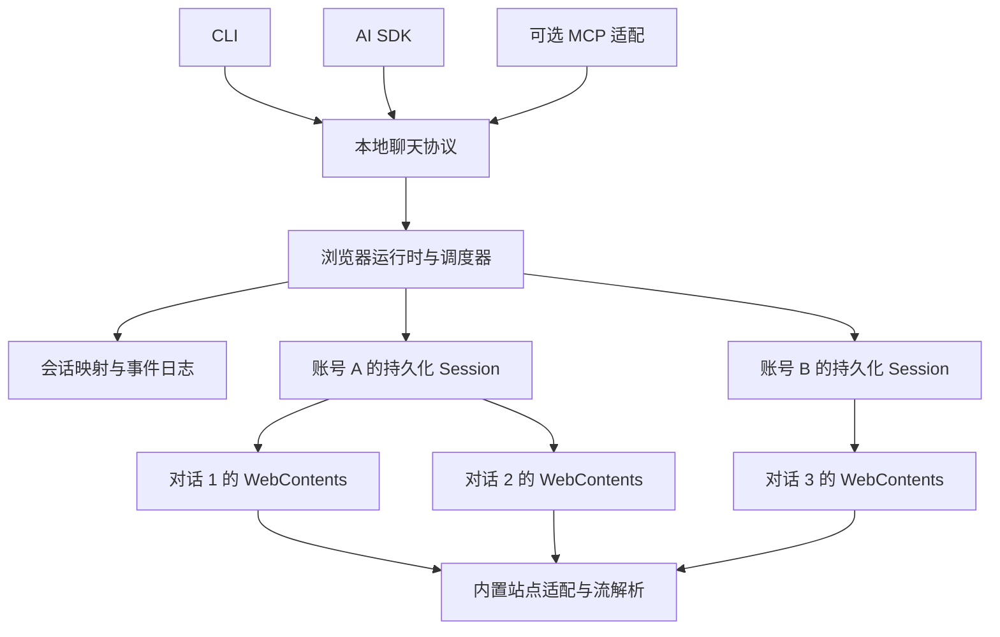

# 0042 面向 AI 和 CLI 的聊天浏览器运行时

## Status

Proposed。先验证浏览器宿主与网页适配方案，再决定产品化实现。

## Owner

TBD

## Date

2026-10-25

## Summary

构建一个面向 AI、CLI 和 SDK 的专用聊天浏览器：浏览器持续运行，管理站点登录、账号、多个对话和回复流，外部调用者使用创建对话、发送、订阅消息、恢复和停止等语义接口。网页解析与操作成为浏览器应用内置的站点适配器。

建议先用 Electron 和 Chromium 做最小宿主，复用 chat-web 已有的站点知识与解析器。核心收益来自会话所有权、事件采集和调度方式的改变；仅把点击脚本搬进应用，仍会遇到原来的网页依赖。CEF 是需要原生响应正文采集时的备选。浏览器内部化不能自动消除站点协议变化、登录限制或账号限流。

## Context

现有实现已具备 SDK、持久化登录、provider adapter 和部分网络回复解析，可以复用。但以下耦合阻碍多个调用者共享浏览器：

| 现有实现 | 对外部调用的影响 |
| --- | --- |
| [profile-manager.ts](../../modules/chat-web/src/core/profile-manager.ts) 按 provider 管理 profile | 尚无显式的 provider 内多账号模型 |
| [browser.ts](../../modules/chat-web/src/core/browser.ts) 每次 open 启动持久化 context，并检查 profile 所有权 | 相同 profile 不能由多个任务分别启动浏览器使用 |
| [session.ts](../../modules/chat-web/src/session.ts) 持有 context 和一个 page，FIFO 串行执行 send 与 newChat，close 关闭 context | 账号、浏览器资源与单个对话生命周期绑定 |
| [chatgpt-sse-collector.ts](../../modules/chat-web/src/providers/chatgpt-sse-collector.ts) 等待 response.finished 后读取正文 | 已能恢复原始 Markdown，但该路径并非逐网络 chunk 输出 |
| [chat-web-session.js](../../modules/ai-sdk/src/providers/chat-web-session.js) 将进度转换为状态预览，最终发送 assistant 消息；interrupt 只设置本地标记 | 缺少独立、可重连的 turn 事件流和已确认的网页停止操作 |
| [resume/chat-web.js](../../modules/ai-sdk/src/resume/chat-web.js) 明确不支持跨进程对话恢复 | 保存 SDK session id 无法保证重启后继续原网页对话 |

需求是让聊天成为浏览器管理的资源：外部调用者无需管理页面、选择器、凭证和浏览器进程，也能管理多个独立会话。

本提案延续 [RFC 0028](0028-chat-web-implementation-plan.md) 的专用站点适配思路，重新设计其单账号串行与会话拥有浏览器的边界。现有运行时行为在迁移前保持有效。

## Goals

- 浏览器持有登录与页面，多个 CLI、AI SDK 客户端共享同一运行时。
- 提供稳定的本地 conversation id、turn id、结构化消息和可重连事件。
- 同一对话保持有序，不同对话按账号能力并发。
- 站点变化通过可测试、升级、回退的适配器处理。
- 用户可以打开具体会话处理登录、验证和异常。

## Non-Goals

- 第一阶段自行开发或 fork Chromium、Blink、JavaScript 引擎。
- 承诺任意网页通用适配、无限并行或所有站点完全相同的能力。
- 将网页订阅等同于官方 API 的配额、可用性和服务保证。
- 第一阶段实现通用浏览器的完整书签、扩展与同步产品。

## Options Considered

| 方案 | 适用性与取舍 |
| --- | --- |
| 常驻 Playwright 宿主 | 最容易复用代码，也能验证多 page 调度；仍沿用外部自动化控制链。适合作为实验和比较基线 |
| Electron 薄浏览器壳 | 与现有 TypeScript 接近，具备 WebContentsView、持久化 session 与进程通信；建议先验证，需要承担 Chromium 分发、更新与兼容测试 |
| 修改开源浏览器 Min | Min 是基于 Electron 的简易浏览器，可参考界面和标签管理；完整 fork 会引入与聊天无关的功能和维护，存在明确 UI 复用收益时再采用 |
| CEF 加最小原生界面 | 支持嵌入 Chromium、进程通信和响应数据过滤；原生控制更直接，需要维护 C++ 集成和跨平台打包 |
| 系统 Chrome 加扩展与本地宿主 | 嵌入式浏览器兼容性不满足时的候选；保留聊天语义协议，重新验证扩展权限与流采集 |
| Tauri 2 默认系统 WebView | 官方文档显示桌面平台分别使用 WebView2 或 WebKit；包体优势需与跨引擎适配成本一起评估 |
| Lightpanda 等新浏览器引擎 | 有面向机器的接口和资源优化方向，但目标站点的登录、流式协议和完整应用行为必须单独验证 |

选型依据：[Electron WebContentsView](https://www.electronjs.org/docs/latest/api/web-contents-view)、[Electron session](https://www.electronjs.org/docs/latest/api/session)、[Min 源码](https://github.com/minbrowser/min)、[Min package.json](https://github.com/minbrowser/min/blob/master/package.json)、[CEF](https://github.com/chromiumembedded/cef)、[Tauri 2 WebView](https://v2.tauri.app/reference/webview-versions/)、[Lightpanda](https://github.com/lightpanda-io/browser)。以上判断针对当前仓库和聊天场景，不代表目标站点已通过验证。

## Proposed Design

### 浏览器宿主与内置适配器



主进程负责账号、页面句柄、调度、IPC 与数据持久化；适配器负责页面就绪、登录检查、发送、解析和停止。适配器内置于浏览器应用，不要求编译进浏览器引擎。

Electron 用 WebContentsView 承载聊天页，通过 preload 与隔离上下文安装受控 DOM 观察器，通过宿主事件处理导航、崩溃和销毁。一个 WebContents 是独立页面资源，不等于每个对话一定拥有独立操作系统进程。[WebContents](https://www.electronjs.org/docs/latest/api/web-contents)

外部不暴露 Playwright Page、任意 JavaScript 执行和选择器。内部以 BrowserHost 封装宿主能力，未来更换 CEF 时保留聊天协议。

### 账号和对话分离

- `Account`：provider 加 accountId，对应专用持久化 session。不同账号隔离存储，同账号多个页面共享登录态。
- `Conversation`：稳定本地 id，关联账号、站点 conversation id、URL 和可选 page 句柄。
- `Turn`：一次发送及回复，拥有独立 turn id、request id、状态和事件序列。

Electron 的 `session.fromPartition('persist:...')` 支持同 partition 页面共享持久化 session，为同账号多对话提供基础。但同账号页面仍可能通过 localStorage、Service Worker 等共享状态，需要验证干扰。[Session partition](https://www.electronjs.org/docs/latest/api/session#sessionfrompartitionpartition-options)

运行时是 profile 的唯一持有者，多个 CLI 连接它，不分别启动浏览器争抢目录。关闭对话只释放其页面，其他对话与登录态继续存在。空闲对话保存映射后可释放页面，需要时重新打开；缺少站点恢复能力时明确返回 unsupported。

Electron 使用新专用数据目录，先要求用户在其中登录，不假设 Playwright profile 可直接当作 Electron partition 使用，不复制活跃 profile 制造并行。

### 发送与回复采集

发送前安装本轮监听器、持久化待发送记录，再操作页面。第一版沿用可验证的站点输入和发送行为，在页面局部执行。若某平台必须短暂聚焦才能发送，只串行化该动作，不在等待回复时独占全局焦点。

回复优先解析网页本身产生的结构化网络数据，保留 Markdown、message id 与明确结束标记；DOM 或可访问性信息用于状态检查和降级读取。现有 ChatGPT SSE 逻辑拆成与 Playwright 无关的纯解析器复用。降级结果携带内容来源与格式保真信息。

Electron 的 `webRequest` 提供请求生命周期、状态和头信息，不能据此直接实现响应正文 chunk 订阅。同一事件只使用最后注册的 listener，因此应由宿主统一分发，避免适配器互相覆盖。[WebRequest](https://www.electronjs.org/docs/latest/api/web-request)

真实流式采集要通过实验选择：

| 采集路径 | 必须验证的边界 |
| --- | --- |
| 页面主世界的最小 fetch 流观察器 | 页面脚本前安装，保留原请求和消费语义，增量解码并限制缓冲；验证取消、背压、导航和站点升级。不能自动覆盖 Worker 或 WebSocket 等路径 |
| Electron debugger 的 CDP 事件与正文能力 | 按实际 Chromium 协议版本验证增量读取，完成后读 body 不算真实流式；该路径仍使用调试协议 |
| CEF 响应数据过滤 | 验证目标请求的 chunk、编码、页面归属与线程处理；没有页面关联的请求不能猜测分配给最近的 turn |

隔离世界与网页主世界拥有不同 JavaScript 全局对象，在隔离 preload 中替换 fetch 不会自动观察网页调用。主世界观察器只传受限数据，不接触文件、进程或账号控制；页面数据作为不可信输入处理。[Context Isolation](https://www.electronjs.org/docs/latest/tutorial/context-isolation)

相关原生能力：[Electron Debugger](https://www.electronjs.org/docs/latest/api/debugger)、[CEF CefResourceRequestHandler](https://github.com/chromiumembedded/cef/blob/master/include/cef_resource_request_handler.h)。CEF 有独立的原生响应过滤入口，但不能由此推导登录或风控兼容性。

不以私有 React store 或手工重放未公开请求作为统一接口基础。网页负责实际登录与发送，适配器归一化可观察结果。

### 状态与恢复

turn 正常路径为 `queued → submitting → streaming → completed`，另有 cancelled、failed、uncertain 终态。auth_required、challenge_required 和 rate_limited 同时影响账号后续调度。

- 先建立 accountId、conversationId、turnId、pageId、navigationEpoch 关联，再补充网络 request id 和站点 message id。无法归属的数据不得作为另一对话的回复。
- 站点终止标记或经验证的页面完成条件才能产生 completed。静默超时、网络中断和部分正文保留 partial 与不确定状态，不能只用两秒无变化判定长推理结束。
- 事件携带递增 seq，支持按 lastSeq 重连。追加文本用 delta，修订用 snapshot，重放按 seq 去重。
- requestId 在账号和对话范围内去重，同 id 不同输入报冲突。发送前失败可重试；提交确认丢失时先核对站点历史，无法确认则 uncertain，不盲目重发。对不支持幂等的站点无法保证端到端 exactly once。
- 重启按站点 id 或 URL 恢复空闲对话，核对账号和身份。生成中的 turn 进入核对流程；已记录事件可重放，中断期间缺失的 token 不保证恢复。
- 停止订阅与停止生成分开。后者调用站点 stop 并确认；无能力或未确认时如实返回，不用断开连接冒充生成已停止。

本地日志保存会话映射、turn 状态、事件和适配器版本，默认不保存 cookie、授权头或完整网络转储。列表注明来自本地记录还是站点历史，不把当前可见 DOM 当成完整历史。

### 并发调度

并行度分为同对话顺序、账号许可、站点限制和机器资源。更多页面只扩展本机执行能力。

- 同一 conversation 的生成串行，多个客户端共用队列；生成中不允许另一客户端改写页面。
- 不同 conversation 用不同 WebContents；账号 semaphore、provider 限流与全局 page 上限共同控制并发。
- 默认每账号并发 1，完成同账号不同对话的 2、4 路实验后再提高，一个 provider 的结果不能套用给其他 provider。
- 队列有长度和等待期限，排队中的 turn 可取消且不触发网页操作。
- 验证后台运行、焦点切换、最小化和休眠。按实测配置节流，避免全局关闭机制后无界创建页面。
- 登录失效或验证要求暂停账号新发送并允许人工接管；限流按信号退避，不靠增加页面数扩展配额。

验收对象是多个独立对话同时生成且回复归属正确，而不是启动多个浏览器进程。

### SDK 与 CLI 协议

建议采用版本化本地 JSON RPC，首先经 Unix domain socket 或 Windows named pipe 传输。CLI 和 AI SDK 共用客户端库，MCP 为可选适配。远程调用后续复用受认证 daemon 通道。

以下为拟议接口，当前版本尚未实现：

| 接口 | 语义 |
| --- | --- |
| providers.capabilities | 声明模型选择、历史、恢复、停止和附件能力 |
| accounts.list / openLogin | 账号状态与登录页面 |
| conversations.create / list / get / resume / close | 管理稳定资源，返回本地 id、站点 id、URL 和数据来源 |
| turns.create / get / cancel | 提交带 requestId 的输入、查询和取消 |
| turns.events | 按 turnId 和 lastSeq 订阅或重放事件 |
| browser.reveal / doctor | 打开指定对话或诊断 |

```ts
const conversation = await client.conversations.create({
  provider: "chatgpt",
  accountId: "personal",
});
const turn = await client.turns.create({
  conversationId: conversation.id,
  requestId: "job-123-turn-1",
  input: [{ type: "text", text: "比较这两种方案" }],
});
for await (const event of client.turns.events({ turnId: turn.id, lastSeq: 0 })) {
  consume(event);
}
```

CLI 同步提供 create、send、events、resume、cancel、login、doctor 等操作，支持 JSON 和 JSONL；调用者使用 conversation id，不管理 tab id。

当前 AI SDK 会采用站点 conversation id。新运行时采用稳定本地 id，另存 providerConversationId；通过版本化映射兼容旧 id，不在首轮回复后替换数据库主键。不支持的附件或历史能力返回明确错误。

### 应用权限边界

远程聊天页面使用 `nodeIntegration: false`、`contextIsolation: true` 和沙箱。宿主校验 WebContents、frame、导航代次及有限消息参数，限制跳转、弹窗和外部协议；账号控制留在可信应用界面。[Electron Security](https://www.electronjs.org/docs/latest/tutorial/security)

本地控制通道限制当前系统用户访问，不向网页公开通用 IPC、shell 或凭证。若增加 localhost HTTP，仍需鉴权与来源校验。适配器随可信版本发布，网页内容不能作为可执行更新。

## Risks

| 风险 | 应对 |
| --- | --- |
| 站点不接受嵌入宿主的登录或聊天 | 最先验证完整流程，必要时评估系统浏览器加扩展并保留聊天协议 |
| 网页与私有流格式变化 | provider 适配版本化，保留脱敏回放 fixture、诊断与回退 |
| 网络覆盖不完整造成丢流或串话 | 验证 Worker、导航和并行请求；无法归属则返回不确定状态 |
| 同账号多页干扰或受站点限制 | 单独做多对话实验，保守设置账号并发 |
| 壳变薄但内存不降 | 测量整个进程树，复用宿主并回收空闲页面，不预设收益倍数 |
| 宿主崩溃影响多个对话 | 重启按日志核对，不自动重发状态不明的消息 |

## Rollout

1. **兼容性实验**：先选一个站点，建议从已有 SSE 解析的 ChatGPT 开始。在 macOS 验证手动登录、新建、多轮、刷新及重启后的登录态，并选定真实流采集路径。宿主无法稳定登录和发送时，先调整选型。
2. **并发与故障实验**：同账号两个独立对话无前台独占地同时生成，观察共享状态、服务端拒绝和资源开销；验证发送确认丢失、崩溃和断连后不重复发送。
3. **最小运行时**：实现账号资源、会话注册表、turn 队列、持久化事件、本地协议与 CLI。先交付一个 provider，再迁移其他站点。
4. **AI SDK 接入**：ChatWebSession 将浏览器所有权交给运行时，以可选 transport 接入；保留原 Playwright 路径供比较和回退。处理恢复、取消与 session id 契约迁移。
5. **产品化**：根据实验选择精简 Electron 应用、Min 界面复用或 CEF 宿主，再覆盖其他平台、更新和分发。

建议逻辑边界为 chat-web-core（协议、状态、纯解析器）、宿主应用与客户端 SDK。第一阶段先在模块内部建立边界，不急于拆分多个发布包。

## Acceptance

以下为后续实现的验收条件：

- 登录一次后多个 CLI 共享运行时，关闭一个客户端不关闭其他对话。
- 两个独立对话生成时间确实重叠、消息零串话；同对话重叠请求保持确定顺序。
- 真实增量采集正确处理长回复、代码块、Markdown、Unicode 跨 chunk 和正文修订。
- 按 seq 重连不重复拼接，重复 requestId 不重复操作发送。
- 重启恢复空闲对话至同一站点会话；生成中断和提交结果不明时保留明确状态。
- stop 得到可验证结果或返回 unsupported / 未确认，登录、验证和限流可接管或退避。
- 同机、同账号、同站点、同模型与提示集，对比当前 chat-web 的 1、2、4 路成功率、回复归属、首段延迟、完成时长及总内存；报告样本量和失败类型后再决定默认并发。
- 具备解析回放、RPC 与调度集成、CLI/SDK 契约和真实浏览器流程验证；文档示例不代表站点兼容性已验证。

## Open Questions

- 首版优先哪个站点，哪些账号的真实流程用于兼容性实验？
- 主要目标是同账号多对话并行，还是多 provider / 多账号统一管理？
- 首版是否必须具备文件、模型切换、联网搜索或站点历史列表？
- “简易”优先指界面、安装体积还是运行内存？薄 Chromium 壳满足前者，后两者需要实测再选宿主与引擎。
